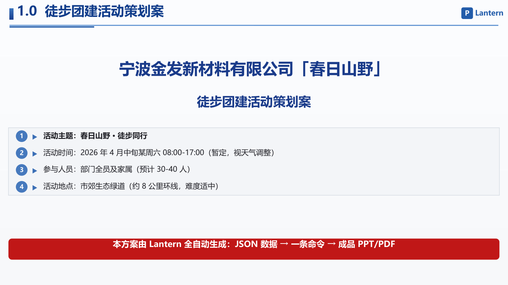
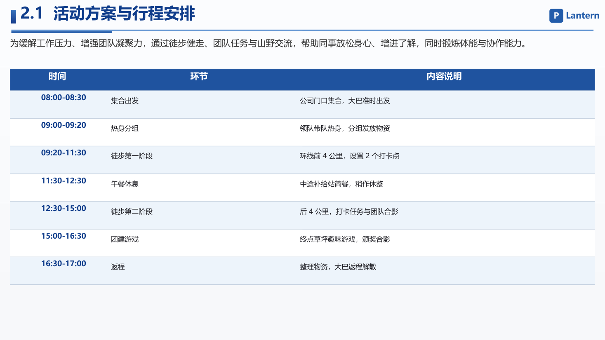
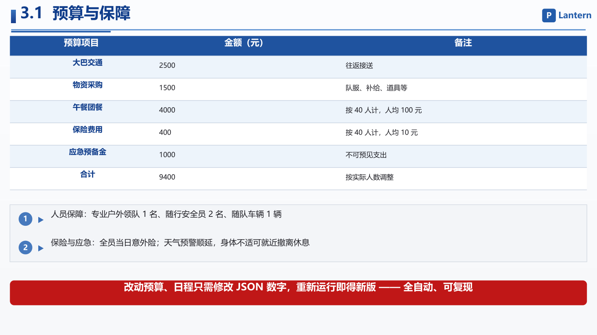

# Lantern

<h3 align="center">自动设计 PPT 的办公自动化平台 —— 一份 JSON，一条命令，一套成品幻灯片</h3>

<p align="center">
  
  
  
  
</p>

---

**Lantern**（灯台）是以**自动设计 PPT** 为核心的办公自动化平台：
通过 Windows COM 自动化操控 WPS 演示，**一份 JSON 数据 → 一条命令 → 成品 PPTX + PDF**，全程零手工排版、可复现、可一键改版。
并附带 WPS 表格数据报表能力（CSV 一键生成带汇总公式与图表插图的 XLSX/PDF），扩展 Zotero 学术文献管理、Photoshop/Illustrator 设计软件控制。

> 「Lantern」即灯台 —— 把「设计一套 PPT」从繁琐排版变为一条命令，
> 让 AI Agent 替你完成重复劳动，回归「用内容表达想法」的本质。

## 为什么做这个项目

日常办公中，策划案、汇报、方案等 PPT 制作存在三座大山：

- **易出错**：手工排版漏页、表格错位、字号不统一，改一版牵一发动全身；
- **不可复现**：每次操作步骤不固定，换人做出来的风格不一致；
- **耗时**：一份策划案 PPT 手工排版约 1–2 小时，反复改稿更耗时。

Lantern 的答案是：**把 PPT 设计固化为一条命令**。
WPS 在 Windows 上暴露了完整的 COM 自动化接口（与 Microsoft Office VBA 兼容），
我们基于该接口构建了 JSON 驱动 PPT 自动设计引擎：封面、图文、表格、红条等元素全部由数据声明，自动排版、自动出片、自动校验。

## 核心场景：自动设计 PPT（全自动化工作流）

```bash
cd WPS/ppt-engine/examples
pip install pywin32 Pillow pymupdf
python build_from_json.py --json lantern/hiking_plan.json --out lantern/out
```

输出（约 10–20 秒，自动校验页数与内容溢出）：

- `lantern/out/徒步团建策划案.pptx` —— WPS 演示成品，可直接放映
- `lantern/out/徒步团建策划案.pdf` —— 每页自适应排版，紧凑出片

演示案例：**宁波金发新材料有限公司徒步团建活动策划案**（3 页：封面 / 行程安排 / 预算与保障）。
改动预算、日程只需修改 JSON 数字，重新运行即得新版 —— **全自动、可复现**。

### 演示效果（一条命令全自动出片，零手工排版）

以下 3 页成品由 `hiking_plan.json` 一条命令生成（WPS 演示逐页截图）：







页眉、表格、红条全部由 JSON 声明并自动排版；改动任意预算/日程数字重新运行，三页同步更新，成品 PPTX 与 PDF 同时产出。

## 平台能力

| 模块 | 能力 |
|------|------|
| `WPS/ppt-engine`（核心新增） | **JSON 驱动 PPT 自动设计引擎**：封面/图文/表格/红条元素、多列表格自动渲染、页面溢出校验、PPTX+PDF 双格式出片 |
| `cli_anything/wps` | WPS 文字/表格/演示 CLI 操控：47 命令 + 数据报表能力（汇总公式、区域格式、图表插图、XLSX/PDF 导出） |
| `cli_anything/zotero` | Zotero 学术研究智能体：27 个 Skill（检索/综述/论文/审稿/期刊图表） |
| `illustrator-harness` | Adobe Illustrator 矢量图编程式创建与编辑 |
| `photoshop-harness` | Adobe Photoshop 位图处理：图层/选区/文本/滤镜/导出 |

## 自动设计 PPT 能力详解（核心新增）

- **JSON 声明式设计**：`slides[]` 一段 JSON 定义整套幻灯片，元素类型含 `header / rich / gray_box / table / redbar`
- **多列表格自动渲染**：任意列数的表格由 JSON 自动拼格（表头蓝底白字、隔行底色、首列强调），规避 WPS AddTable 边框不稳定
- **页面溢出校验**：出片时逐页检测内容越界，`[verify] 页数=N 溢出=0` 保证成品不破版
- **一键改版**：改 JSON 数字（预算、日程、人员）重新运行即得新版，双格式同步更新
- **16 套高校招生 PPT 案例**：清华/北大/复旦/中科大等，含完整 build 脚本与 data.json，可直接复用为模板

## 快速上手

```bash
# 自动设计 PPT（核心场景）
cd WPS/ppt-engine/examples && python build_from_json.py --json lantern/hiking_plan.json --out lantern/out

# 数据报表（附带能力）
cd report_demo && python build_report.py

# WPS 办公
cli-anything-wps document new --type impress --name "演示"
cli-anything-wps export render output.pptx -p pptx

# Zotero 学术
cli-anything-zotero skills pipeline thesis

# Illustrator / Photoshop 设计
cli-anything-illustrator project new logo.ai -w 500 -h 500
cli-anything-photoshop project new banner.psd -w 1920 -h 1080
```

## 系统要求

- Windows 10/11
- WPS Office 12.0+（PPT 自动设计 + 数据报表）/ Zotero 7+ / Adobe Illustrator 2023+ / Adobe Photoshop 2023+（可选）
- Python 3.10+ + pywin32 + Pillow + pymupdf + matplotlib + openpyxl

## 许可证

MIT（见 [LICENSE](LICENSE)）
